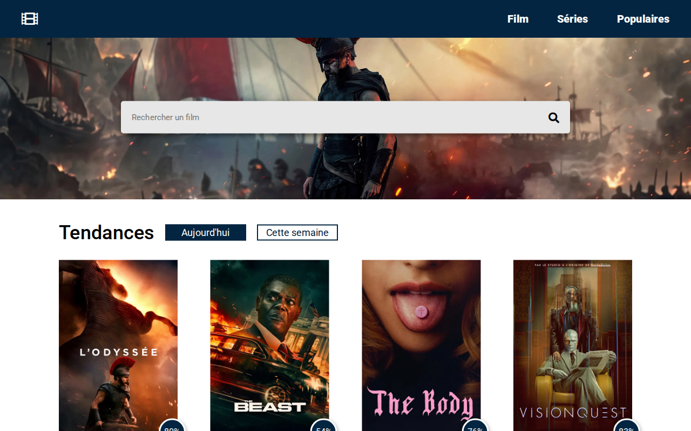

# 🎬 Movie Explorer

A responsive website to browse trending movies, TV shows and actors, powered by [The Movie Database (TMDB) API](https://developer.themoviedb.org/).

**🔗 Live demo:** https://arno-dubois.github.io/Projet-WEB/



## Features

- **Trending** movies & shows, by day or by week
- **Top rated / popular** TV shows and movies
- **Search** across movies, shows and people, with year and rating filters
- **Movie / show details**: synopsis, genres, runtime, cast and trailer
- **Actor pages** with biography and filmography
- Responsive layout with a mobile burger menu and a custom 404 page

## Tech stack

- Vanilla JavaScript (ES modules), no framework
- SCSS following the 7-1 pattern
- [Vite](https://vitejs.dev/) for the dev server and production build
- GitHub Actions + GitHub Pages for deployment

## Project structure

```
├── index.html, focus.html, actor-focus.html, 404.html   # pages
├── js/
│   ├── fetch/      # TMDB API calls and per-page loaders
│   ├── display/    # DOM rendering
│   └── general/    # DOM selectors, settings (token)
├── sass/           # 7-1 pattern: abstracts, base, components, layout, pages
├── img/            # images bundled through SCSS
└── public/img/     # images referenced at runtime from JS
```

## Getting started

Requirements: Node.js 20+ and a free TMDB account.

```bash
npm install
cp .env.example .env   # then paste your TMDB "API Read Access Token"
npm run dev            # http://localhost:5173
```

| Script            | Description                       |
| ----------------- | --------------------------------- |
| `npm run dev`     | Start the dev server              |
| `npm run build`   | Build the static site to `dist/`  |
| `npm run preview` | Serve the production build        |

### About the API token

The app is fully client-side, so the TMDB token is injected **at build time** from the `VITE_TMDB_TOKEN` environment variable and ends up in the built JavaScript. That means:

- the token is never committed to the repository (`.env` is git-ignored);
- it **is** visible to anyone inspecting the deployed site. Use a TMDB *read-only* token, which is acceptable for a public, read-only demo like this one.

## Deployment

Every push to `main` builds and deploys the site to GitHub Pages (`.github/workflows/deploy.yml`). One-time setup:

1. **Settings → Secrets and variables → Actions**: add a repository secret `TMDB_TOKEN`.
2. **Settings → Pages**: set *Source* to **GitHub Actions**.

---

This product uses the TMDB API but is not endorsed or certified by TMDB.
